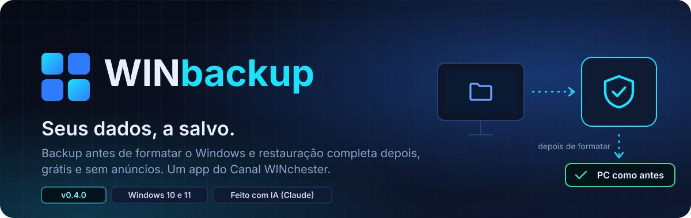
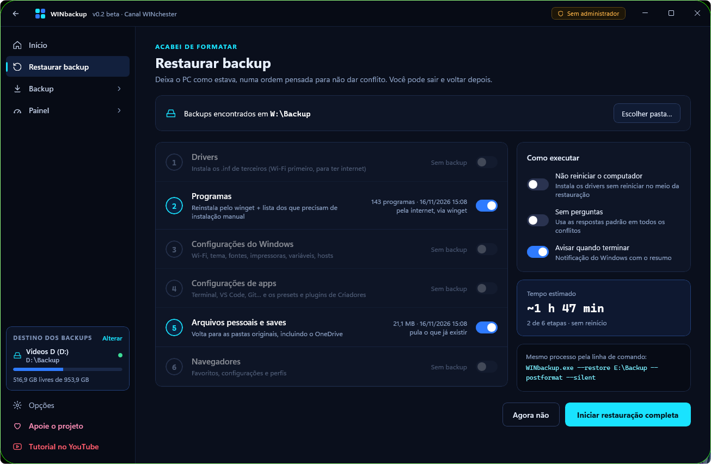

<p align="center">
  
</p>

<p align="center">
  <a href="README.md">🇧🇷 Português</a> · <b>🇺🇸 English</b> · <a href="README.es.md">🇪🇸 Español</a>
</p>

<p align="center">
  <a href="https://github.com/winchestercanal/WINbackup/releases"></a>
  <a href="https://github.com/winchestercanal/WINbackup/releases"></a>
  
  
</p>

<p align="center">
  <a href="#-download"><b>Download</b></a> ·
  <a href="#-what-it-backs-up"><b>What it backs up</b></a> ·
  <a href="#-screenshots"><b>Screenshots</b></a> ·
  <a href="#-feedback"><b>Feedback</b></a> ·
  <a href="#-support"><b>Support</b></a>
</p>

**WINbackup** is a free Windows app from **[Canal WINchester](https://www.youtube.com/WINchesterCanal)** (a Brazilian tech channel) that backs up everything that matters before you format your PC, and puts it back the way it was afterwards: files, programs, settings, game saves, drivers, browsers and the presets of your creative apps.

<p align="center"><b>Open it, back up, then restore. Simple, fast and efficient.</b></p>

> [!NOTE]
> The app is available in **English**, Portuguese and Spanish (it follows your Windows language; you can change it in **Options**). The screenshots below show the Portuguese interface.

### 💡 Why WINbackup exists

> For years I tried countless backup tools. They all needed a lot of tweaking and none of them did everything I needed, which forced me to use several tools for a single purpose.
>
> WINbackup was made to turn the tiring job of backing up and restoring files, programs and drivers into something **simple, fast and efficient**. You open it, run the backup and restore it later.
>
> **No complicated settings, no choosing between confusing terms, and no chance of forgetting something and only remembering when it's too late.**
>
> — *Canal WINchester*

> [!IMPORTANT]
> 🤖 **This app was built with artificial intelligence.** The code was written by **Claude**, Anthropic's AI, based on Canal WINchester's prototype and decisions; the channel guided, reviewed and tested every step.

> [!WARNING]
> **Version 0.4.0.** As with any backup tool, **keep an extra copy of your important files** and let us know what you find.

<p align="center">
  
</p>

## ✨ Why WINbackup

<table>
  <tr>
    <td width="33%" valign="top">
      <br>
      <b>Actually safe</b><br>
      <sub>Checks every file with SHA-256, copies files in use through Windows Shadow Copy and never sends anything to the internet.</sub>
    </td>
    <td width="33%" valign="top">
      <br>
      <b>Guided post-format restore</b><br>
      <sub>After formatting, it restores drivers, programs, settings and files in the right order, with one click.</sub>
    </td>
    <td width="33%" valign="top">
      <br>
      <b>Plain folders, no lock-in</b><br>
      <sub>The backup is stored as regular folders on an external drive, another disk or the network. You can open and copy it without the app.</sub>
    </td>
  </tr>
  <tr>
    <td valign="top">
      <br>
      <b>Incremental, with versions</b><br>
      <sub>Copies only what changed and keeps the latest versions. You choose which day to restore from.</sub>
    </td>
    <td valign="top">
      <br>
      <b>On autopilot</b><br>
      <sub>Schedule it by time, when the external drive is plugged in, or when you sign in to Windows.</sub>
    </td>
    <td valign="top">
      <br>
      <b>Portable</b><br>
      <sub>No installation needed. Runs straight from a folder or a USB stick.</sub>
    </td>
  </tr>
</table>

## 🔄 How it works

<table>
  <tr>
    <td align="center" width="33%">
      <br>
      <b>1. Back up</b><br>
      <sub>Pick one or more presets (full, documents, dev, gamer or creators) and the destination.</sub>
    </td>
    <td align="center" width="33%">
      <br>
      <b>2. Format the PC</b><br>
      <sub>Your data stays safe on the external drive, in plain folders.</sub>
    </td>
    <td align="center" width="33%">
      <br>
      <b>3. Restore everything</b><br>
      <sub>Open WINbackup on the new Windows and click Restore backup: it finds the drive by itself.</sub>
    </td>
  </tr>
</table>

## 📦 What it backs up

| Module | What it does |
|---|---|
| <br>**Personal files** | Documents, Pictures, Desktop, Downloads and any folders you choose. Detects OneDrive folders and keeps empty folders |
| <br>**Creators** | Presets, workspaces, scripts and plugins for Premiere, After Effects, Photoshop, Illustrator, Lightroom, DaVinci Resolve, OBS, Stream Deck, Voicemeeter, Blender and more |
| <br>**Programs** | Lists what's installed through winget, reinstalls everything by itself after formatting and creates a list of the ones you need to install by hand |
| <br>**Browsers** | Bookmarks, settings and profiles for Edge, Chrome, Brave, Vivaldi, Opera, Firefox and Zen, plus the extension list with store links. Passwords: guided export, the app never reads them |
| <br>**Settings** | Wi-Fi networks, theme and wallpaper, printers, fonts, environment variables, hosts and Windhawk mods, plus Terminal, PowerShell, VS Code, Git and more |
| <br>**Game saves** | My Games, Saved Games, Unreal and Unity games, Steam Cloud and Ubisoft |
| <br>**Drivers** | Exports third-party drivers with PnPUtil and reinstalls them later |
| <br>**Restore backup** | Finds the backup on the connected drive by itself and brings back drivers, programs, settings, files and browsers in the right order. You choose which steps run |
| <br>**Schedules** | Automatic backups through Windows Task Scheduler |
| <br>**Command line** | Everything also runs from the terminal, for scripts and automation |
| <br>**Themes and languages** | Portuguese, English and Spanish. WINchester (default), dark, OLED dark and light themes, in Options |
| <br>Encryption | *In development* |

## 📸 Screenshots

<table>
  <tr>
    <td width="50%"><p align="center"><sub><b>Personal files</b>: user folders, OneDrive, exclusions and Shadow Copy</sub></p></td>
    <td width="50%"><p align="center"><sub><b>Creators</b>: presets and plugins for Adobe, DaVinci, OBS and more</sub></p></td>
  </tr>
  <tr>
    <td><p align="center"><sub><b>Restore backup</b>: finds the backup and puts the PC back the way it was, in the right order</sub></p></td>
    <td><p align="center"><sub><b>Game saves</b>: finds your games' progress</sub></p></td>
  </tr>
</table>

## 📥 Download

<p align="center">
  <a href="https://github.com/winchestercanal/WINbackup/releases"></a>
</p>

1. Under **[Releases](https://github.com/winchestercanal/WINbackup/releases)**, download **`WINbackup-….exe`** from the latest version.
2. Open the file and accept the administrator prompt. That's it: it's a single file, nothing to install or extract. You can carry it on a USB stick.
3. Prefer a folder with loose files? Download the `.zip`, extract it and open the `WINbackup.exe` inside.

The first time, the app takes a few extra seconds to open because it unpacks itself into a temporary folder. To keep the settings next to the `.exe` (truly portable, without touching the PC), turn on **Options → Portable mode**.

> [!NOTE]
> Windows may show **"Windows protected your PC"** because the app isn't digitally signed yet. Click **More info → Run anyway**.

**Safe first test:** choose an empty destination (a USB stick or a test folder), back up only **Personal files**, delete a test file and use **Restore backup** with only the files step turned on: it comes back without touching what already exists.

**Requirements:** Windows 10 (2004) or 11, 64-bit. Must run as administrator (for drivers and Shadow Copy).

## 💬 Feedback

Found a bug or have a suggestion? **[Open an issue](https://github.com/winchestercanal/WINbackup/issues/new)** (English is fine) telling us:

- what you did and what you expected to happen;
- your Windows version;
- if possible, the files from the `Logs` folder inside the backup (`WINbackup_<date>\Logs`) or from `%APPDATA%\WINbackup\logs`.

## ⌨️ Command line

```powershell
WINbackup.exe --preset completo --dest E:\Backup  # full backup
WINbackup.exe --only apps,configs --silent        # programs and settings only, no window
WINbackup.exe --restore E:\Backup --postformat    # post-format restore
```

The backup is stored as plain folders in the destination you choose, with a `manifest.json` and a log for each run. **Nothing is sent to the internet.**

<details>
<summary><b>🛠️ Build from source</b></summary>

<br>

Requires the .NET 10 SDK.

```bash
dotnet publish -c Release -r win-x64 --self-contained true -o publish/WINbackup WINbackup/WINbackup.csproj
```

Built with **WinUI 3** (Windows App SDK) and **.NET 10**. Architecture, backup format and how to test without UAC are in [`DEVELOPMENT.md`](DEVELOPMENT.md) (in Portuguese). The interface prototype and design decisions are in [`interface/HANDOFF.md`](interface/HANDOFF.md).

</details>

## 💙 Support

WINbackup is free and has no ads. If it helped you, consider supporting the project:

<p>
  <a href="https://www.paypal.com/donate/?hosted_button_id=SANZPNKWBY8GN"></a>
  <a href="https://livepix.gg/canalwinchester"></a>
  <a href="https://www.youtube.com/WINchesterCanal"></a>
</p>

<p align="center"><sub>Made with 🤖 AI and 💙 by Canal WINchester</sub></p>
