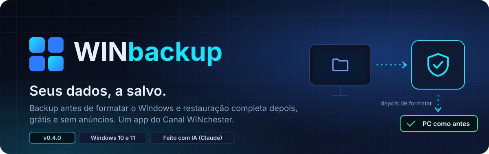
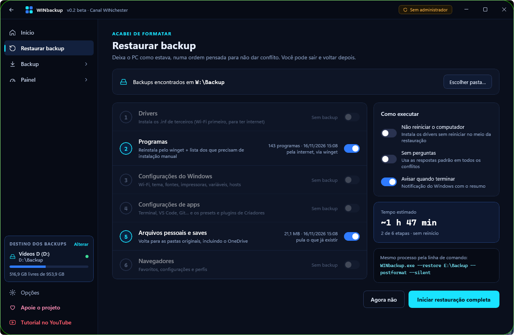

<p align="center">
  
</p>

<p align="center">
  <a href="README.md">🇧🇷 Português</a> · <a href="README.en.md">🇺🇸 English</a> · <b>🇪🇸 Español</b>
</p>

<p align="center">
  <a href="https://github.com/winchestercanal/WINbackup/releases"></a>
  <a href="https://github.com/winchestercanal/WINbackup/releases"></a>
  
  
</p>

<p align="center">
  <a href="#-descargar"><b>Descargar</b></a> ·
  <a href="#-qué-guarda"><b>Qué guarda</b></a> ·
  <a href="#-pantallas"><b>Pantallas</b></a> ·
  <a href="#-comentarios"><b>Comentarios</b></a> ·
  <a href="#-apoya"><b>Apoya</b></a>
</p>

**WINbackup** es una app gratuita para Windows del **[Canal WINchester](https://www.youtube.com/WINchesterCanal)** (un canal brasileño de tecnología) que hace una copia de todo lo importante antes de formatear y deja el PC como estaba después: archivos, programas, configuración, partidas guardadas, drivers, navegadores y los presets de tus apps de creación.

<p align="center"><b>Ábrela, haz la copia y después restaura. Simple, rápido y eficiente.</b></p>

> [!NOTE]
> La app está en **español**, portugués e inglés (sigue el idioma de Windows; puedes cambiarlo en **Opciones**). Las capturas de abajo muestran la interfaz en portugués.

### 💡 Por qué existe WINbackup

> Durante años probé innumerables herramientas de copia de seguridad. Todas necesitaban muchos ajustes y ninguna hacía todo lo que yo necesitaba, lo que me obligaba a usar varias herramientas para un solo propósito.
>
> WINbackup nació para convertir la cansadora tarea de hacer y restaurar copias de archivos, programas y drivers en algo **simple, rápido y eficiente**. La abres, haces la copia y después restauras.
>
> **Sin configuraciones complicadas, sin elegir entre términos difíciles y sin la posibilidad de olvidar algo y acordarte solo cuando ya es demasiado tarde.**
>
> — *Canal WINchester*

> [!IMPORTANT]
> 🤖 **Esta aplicación fue creada con inteligencia artificial.** El código lo escribió **Claude**, la IA de Anthropic, a partir del prototipo y las decisiones del Canal WINchester, que orientó, revisó y probó cada etapa.

> [!WARNING]
> **Versión 0.4.0.** Como con cualquier herramienta de copia de seguridad, **guarda una copia extra de tus archivos importantes** y cuéntanos lo que encuentres.

<p align="center">
  
</p>

## ✨ Por qué WINbackup

<table>
  <tr>
    <td width="33%" valign="top">
      <br>
      <b>Seguro de verdad</b><br>
      <sub>Comprueba cada archivo con SHA-256, copia archivos en uso con Shadow Copy de Windows y nunca envía nada a internet.</sub>
    </td>
    <td width="33%" valign="top">
      <br>
      <b>Restauración guiada</b><br>
      <sub>Después de formatear, restaura drivers, programas, configuración y archivos en el orden correcto, con un clic.</sub>
    </td>
    <td width="33%" valign="top">
      <br>
      <b>Carpetas normales, sin ataduras</b><br>
      <sub>La copia queda en carpetas normales en el disco externo, otro disco o la red. Puedes abrirla y copiarla sin la app.</sub>
    </td>
  </tr>
  <tr>
    <td valign="top">
      <br>
      <b>Incremental con versiones</b><br>
      <sub>Copia solo lo que cambió y guarda las últimas versiones. Tú eliges de qué día restaurar.</sub>
    </td>
    <td valign="top">
      <br>
      <b>En automático</b><br>
      <sub>Prográmala por horario, al conectar el disco externo o al iniciar sesión en Windows.</sub>
    </td>
    <td valign="top">
      <br>
      <b>Portátil</b><br>
      <sub>No hace falta instalar. Funciona directo desde la carpeta o un pendrive.</sub>
    </td>
  </tr>
</table>

## 🔄 Cómo funciona

<table>
  <tr>
    <td align="center" width="33%">
      <br>
      <b>1. Haz la copia</b><br>
      <sub>Elige uno o más presets (completo, documentos, dev, gamer o creadores) y el destino.</sub>
    </td>
    <td align="center" width="33%">
      <br>
      <b>2. Formatea el PC</b><br>
      <sub>Tus datos quedan guardados en el disco externo, en carpetas normales.</sub>
    </td>
    <td align="center" width="33%">
      <br>
      <b>3. Restaura todo</b><br>
      <sub>Abre WINbackup en el Windows nuevo y haz clic en Restaurar copia: encuentra el disco solo.</sub>
    </td>
  </tr>
</table>

## 📦 Qué guarda

| Módulo | Qué hace |
|---|---|
| <br>**Archivos personales** | Documentos, Imágenes, Escritorio, Descargas y las carpetas que elijas. Detecta carpetas en OneDrive y mantiene las carpetas vacías |
| <br>**Creadores** | Presets, espacios de trabajo, scripts y plugins de Premiere, After Effects, Photoshop, Illustrator, Lightroom, DaVinci Resolve, OBS, Stream Deck, Voicemeeter, Blender y otros |
| <br>**Programas** | Lista lo instalado con winget, lo reinstala todo solo después de formatear y genera la lista de los que hay que instalar a mano |
| <br>**Navegadores** | Favoritos, configuración y perfiles de Edge, Chrome, Brave, Vivaldi, Opera, Firefox y Zen, además de la lista de extensiones con enlace a la tienda. Contraseñas: exportación guiada, la app nunca las lee |
| <br>**Configuración** | Redes Wi-Fi, tema y fondo de pantalla, impresoras, fuentes, variables de entorno, hosts y mods de Windhawk, además de Terminal, PowerShell, VS Code, Git y otros |
| <br>**Partidas guardadas** | My Games, Saved Games, juegos Unreal y Unity, Steam Cloud y Ubisoft |
| <br>**Drivers** | Exporta los drivers de terceros con PnPUtil y los reinstala después |
| <br>**Restaurar copia** | Encuentra la copia sola en el disco conectado y devuelve drivers, programas, configuración, archivos y navegadores en el orden correcto. Tú eliges qué etapas entran |
| <br>**Programaciones** | Copias automáticas con el Programador de tareas de Windows |
| <br>**Línea de comandos** | Todo funciona también desde la terminal, para scripts y automatizaciones |
| <br>**Temas e idiomas** | Portugués, inglés y español. Temas WINchester (el predeterminado), oscuro, oscuro OLED y claro, en Opciones |
| <br>Cifrado | *En desarrollo* |

## 📸 Pantallas

<table>
  <tr>
    <td width="50%"><p align="center"><sub><b>Archivos personales</b>: carpetas del usuario, OneDrive, exclusiones y Shadow Copy</sub></p></td>
    <td width="50%"><p align="center"><sub><b>Creadores</b>: presets y plugins de Adobe, DaVinci, OBS y otros</sub></p></td>
  </tr>
  <tr>
    <td><p align="center"><sub><b>Restaurar copia</b>: encuentra la copia y deja el PC como estaba, en el orden correcto</sub></p></td>
    <td><p align="center"><sub><b>Partidas guardadas</b>: encuentra el progreso de tus juegos</sub></p></td>
  </tr>
</table>

## 📥 Descargar

<p align="center">
  <a href="https://github.com/winchestercanal/WINbackup/releases"></a>
</p>

1. En **[Releases](https://github.com/winchestercanal/WINbackup/releases)**, descarga el **`WINbackup-….exe`** de la versión más reciente.
2. Abre el archivo y acepta el aviso de administrador. Listo: es un solo archivo, no hay que instalar ni extraer nada. Puedes llevarlo en un pendrive.
3. ¿Prefieres la carpeta con los archivos sueltos? Descarga el `.zip`, extráelo y abre el `WINbackup.exe` de dentro.

La primera vez la app tarda unos segundos más en abrir, porque se prepara en una carpeta temporal. Para guardar la configuración junto al `.exe` (modo portátil de verdad, sin tocar el PC), activa **Opciones → Modo portátil**.

> [!NOTE]
> Windows puede mostrar **"Windows protegió tu PC"** porque la app todavía no tiene firma digital. Haz clic en **Más información → Ejecutar de todas formas**.

**Primera prueba segura:** elige un destino vacío (pendrive o carpeta de prueba), haz la copia solo de **Archivos personales**, borra un archivo de prueba y usa **Restaurar copia** dejando activada solo la etapa de archivos: vuelve sin tocar lo que ya existe.

**Requisitos:** Windows 10 (2004) u 11, 64 bits. Debe ejecutarse como administrador (para drivers y Shadow Copy).

## 💬 Comentarios

¿Encontraste un error o tienes una sugerencia? **[Abre un issue](https://github.com/winchestercanal/WINbackup/issues/new)** (puedes escribir en español) contando:

- qué hiciste y qué esperabas que pasara;
- la versión de Windows;
- si es posible, los archivos de la carpeta `Logs` dentro de la copia (`WINbackup_<fecha>\Logs`) o de `%APPDATA%\WINbackup\logs`.

## ⌨️ Línea de comandos

```powershell
WINbackup.exe --preset completo --dest E:\Backup  # copia completa
WINbackup.exe --only apps,configs --silent        # solo programas y configuración, sin ventana
WINbackup.exe --restore E:\Backup --postformat    # restauración después de formatear
```

La copia queda en carpetas normales en el destino que elijas, con un `manifest.json` y un registro por ejecución. **Nada se envía a internet.**

<details>
<summary><b>🛠️ Compilar desde el código</b></summary>

<br>

Requiere el SDK de .NET 10.

```bash
dotnet publish -c Release -r win-x64 --self-contained true -o publish/WINbackup WINbackup/WINbackup.csproj
```

Hecho con **WinUI 3** (Windows App SDK) y **.NET 10**. La arquitectura, el formato de la copia y cómo probar sin UAC están en [`DEVELOPMENT.md`](DEVELOPMENT.md) (en portugués). El prototipo de la interfaz y las decisiones de diseño están en [`interface/HANDOFF.md`](interface/HANDOFF.md).

</details>

## 💙 Apoya

WINbackup es gratuito y sin anuncios. Si te ayudó, considera apoyar el proyecto:

<p>
  <a href="https://www.paypal.com/donate/?hosted_button_id=SANZPNKWBY8GN"></a>
  <a href="https://livepix.gg/canalwinchester"></a>
  <a href="https://www.youtube.com/WINchesterCanal"></a>
</p>

<p align="center"><sub>Hecho con 🤖 IA y 💙 por el Canal WINchester</sub></p>
